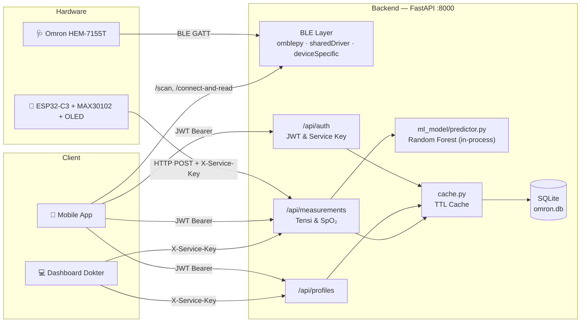

# SENSOR-MAX-FINAL-OLED — Remote Patient Monitoring Backend

> Backend FastAPI + firmware ESP32 untuk sistem *Remote Patient Monitoring* (RPM) multi-user dan multi-profil.

## 1. Executive Summary

Proyek ini menyatukan data kesehatan dari dua perangkat berbeda, yaitu **tensimeter Omron HEM-7155T** (via Bluetooth Low Energy) dan **oksimeter ESP32-C3 + MAX30102 dengan layar OLED** (via WiFi/HTTP), ke dalam satu REST API dan satu database. Masalah yang diselesaikan: data tekanan darah, SpO₂, BPM, dan suhu yang biasanya tersebar di alat masing-masing kini tersimpan per profil anggota keluarga, dan dapat diakses aplikasi mobile maupun dashboard dokter. Sistem juga memberikan **estimasi kadar gula darah** dari model Machine Learning (Random Forest) yang berjalan *in-process* di server.

---

## 2. Documentation Roadmap

Baca berurutan dari atas ke bawah. Semakin ke bawah, semakin detail atau semakin bersifat arsip.

| # | Dokumen | Fokus |
|---|---------|-------|
| 1 | **README.md** (file ini) | Gambaran besar, setup lokal, dan peta dokumentasi. |
| 2 | [dokumentasi_api_lengkap.md](./dokumentasi_api_lengkap.md) | **Referensi API paling mutakhir**: seluruh endpoint, *dual auth* (JWT & `X-Service-Key`), *active session* SpO₂, panduan Postman langkah demi langkah, dan detail fitur model ML. |
| 3 | [DOKUMENTASI_LENGKAP.md](./DOKUMENTASI_LENGKAP.md) | Pembahasan teknis mendalam: diagram arsitektur & sequence, ERD, protokol BLE omblepy, firmware, optimasi performa, troubleshooting, dan catatan keamanan. |
| 4 | [DOKUMENTASI_HEM7155T.md](./DOKUMENTASI_HEM7155T.md) | Spesifikasi level rendah Omron HEM-7155T: hierarki class driver, *memory map* EEPROM, dan format *binary record* 16 byte. |
| 5 | [omblepy-esp32bridge/README.md](./omblepy-esp32bridge/README.md) | Alternatif pembacaan Omron melalui ESP32 sebagai *BLE bridge* via USB serial (melewati stack Bluetooth OS). |
| 6 | [DOKUMENTASI_LENGKAP_080626.md](./DOKUMENTASI_LENGKAP_080626.md) | *Arsip*: salinan identik dari `DOKUMENTASI_HEM7155T.md`, tidak perlu dibaca. |
| 7 | [readmeNEW.md](./readmeNEW.md) | *Arsip*: dokumentasi API versi lama; sudah digantikan oleh dokumen #2. |

> [!NOTE]
> Beberapa bagian di dokumen #3 dan #4 ditulis untuk versi sebelumnya. Jika ada perbedaan, **kode sumber dan dokumen #2 adalah acuan utama**. Perbedaan yang sudah diketahui:
> - Prediksi gula darah kini berjalan **in-process** ([ml_model/predictor.py](./ml_model/predictor.py)), bukan lewat ML API eksternal. Variabel `ML_API_URL` tidak lagi dipakai.
> - Firmware yang aktif adalah [max30102_esp32c3_oled_oximeter/](./max30102_esp32c3_oled_oximeter/) untuk **ESP32-C3 + OLED**, bukan `MAX30102_BPM_SPO2.ino` untuk ESP32-S3.

---

## 3. Tech Stack & Prerequisites

### Tech Stack

| Layer | Teknologi |
|-------|-----------|
| Backend API | Python 3.10+, FastAPI, Uvicorn, Pydantic |
| Database | SQLite (`omron.db`) + SQLAlchemy 2 (WAL mode, PRAGMA tuning) |
| Auth | JWT (`python-jose`), bcrypt (`passlib`), Service Key untuk *server-to-server* |
| BLE Omron | `bleak` + [omblepy.py](./omblepy.py) + driver per model di [deviceSpecific/](./deviceSpecific/) |
| Machine Learning | scikit-learn (Random Forest v6), joblib, pandas |
| Performa | `cachetools` (TTL cache), GZip middleware, `aiofiles`, `orjson` |
| Firmware | Arduino C++ untuk ESP32-C3, sensor MAX30102, OLED SSD1306 (U8g2) |
| Load test | k6 ([k6_stress_test.js](./k6_stress_test.js)) |

### Prasyarat Environment

- **OS:** Windows 10/11 (disarankan, karena BLE melalui stack Windows) dengan adapter **Bluetooth 4.0+ (BLE)**.
- **Python** 3.10+ dan `pip`, serta **Git**.
- **Arduino IDE 2.x** dengan board package ESP32 dan library **U8g2**. Ini hanya dibutuhkan jika ingin mem-*flash* firmware.
- **Hardware (opsional untuk pengembangan API):** Omron HEM-7155T, ESP32-C3, sensor MAX30102, OLED SSD1306 128×64.
- ESP32 dan server berada di **jaringan yang sama**, atau server dapat diakses publik.

---

## 4. Quick Start

### 4.1 Menjalankan Backend

```powershell
# 1. Clone repository
git clone repo ini
cd SENSOR-MAX-FINAL-OLED

# 2. Buat & aktifkan virtual environment
python -m venv .venv
.venv\Scripts\activate            # Linux/Mac: source .venv/bin/activate

# 3. Install dependencies
pip install -r requirements.txt
# Di jaringan kampus/proxy yang memblokir SSL, tambahkan:
#   --trusted-host pypi.org --trusted-host files.pythonhosted.org

# 4. Siapkan file .env
copy .env.example .env            # Linux/Mac: cp .env.example .env
python secretkey-generate.py      # salin hasilnya ke SECRET_KEY di .env

# 5. (Opsional) Tambahkan index database untuk performa
python migrate_indexes.py

# 6. Jalankan server
python -m uvicorn main:app --reload --host 0.0.0.0 --port 8000
```

Lalu buka **Swagger UI** di `http://localhost:8000/docs` (atau ReDoc di `/redoc`).

### 4.2 Variabel Environment (`.env`)

| Variabel | Wajib | Default | Keterangan |
|----------|:-----:|---------|------------|
| `SECRET_KEY` | ✅ | – | Kunci tanda tangan JWT. Server **gagal start** jika kosong. |
| `SERVICE_KEY` | ⚠️ | – | Kunci untuk header `X-Service-Key` (ESP32 & dashboard dokter). Wajib jika ESP32 dipakai. |
| `BCRYPT_ROUNDS` | – | `4` | Gunakan `4` untuk dev dan `10` untuk production. |
| `LOG_LEVEL` | – | `WARNING` | `DEBUG` / `INFO` / `WARNING` / `ERROR`. |

### 4.3 Flash Firmware ESP32-C3 (Opsional)

1. Buka [max30102_esp32c3_oled_oximeter.ino](./max30102_esp32c3_oled_oximeter/max30102_esp32c3_oled_oximeter.ino) di Arduino IDE.
2. Sesuaikan konstanta `ssid`, password WiFi, `server_url`, dan nilai header `X-Service-Key` (harus sama dengan `SERVICE_KEY` di server).
3. Wiring: **MAX30102** SDA→GPIO 8, SCL→GPIO 9 · **OLED** SDA→GPIO 4, SCL→GPIO 5 · LED heartbeat→GPIO 10.
4. Pilih board **ESP32C3 Dev Module**, pilih port COM, lalu **Upload**. Pantau Serial Monitor di 115200 baud.

### 4.4 Uji Alur Dasar

Ikuti urutan **Register → Login → Buat Profil → Simpan Pengukuran** pada bagian *Panduan Penggunaan di Postman* di [dokumentasi_api_lengkap.md](./dokumentasi_api_lengkap.md).

---

## 5. Core Architecture Overview



**Alur utama dalam satu kalimat per langkah:**

1. User **register/login** dan mendapat JWT, lalu membuat **profil** untuk tiap anggota keluarga.
2. **Tekanan darah:** aplikasi memanggil `/scan` dan `/connect-and-read`, backend membaca record dari Omron via BLE, lalu data disimpan ke `POST /api/measurements`.
3. **SpO₂:** aplikasi menetapkan *active session* (`POST /api/measurements/spo2/active-session`) untuk profil yang sedang diukur, lalu ESP32 mengirim data ke `POST /api/measurements/spo2`.
4. Saat data SpO₂ masuk, backend menggabungkannya dengan data tensi terakhir sebagai fitur model ML, menghitung **estimasi gula darah**, lalu menyimpan hasilnya.

### Peta Kode Singkat

| Path | Peran |
|------|-------|
| [main.py](./main.py) | Entry point FastAPI, middleware (CORS, GZip), endpoint BLE, dan auto-migration saat startup. |
| [routers/](./routers/) | `auth.py`, `profiles.py`, `measurements.py`: satu router per domain. |
| [models.py](./models.py) / [schemas.py](./schemas.py) | Model ORM SQLAlchemy dan skema request/response Pydantic. |
| [database.py](./database.py) / [cache.py](./cache.py) | Engine & session DB, serta TTL cache in-memory. |
| [omblepy.py](./omblepy.py), [sharedDriver.py](./sharedDriver.py), [deviceSpecific/](./deviceSpecific/) | Protokol BLE Omron beserta driver per model (HEM-7155T, 7142T, 7322T, dll.). |
| [ml_model/](./ml_model/) | Model, scaler, dan metadata v6 serta skrip training `train_v6.py`. |
| [max30102_esp32c3_oled_oximeter/](./max30102_esp32c3_oled_oximeter/) | Firmware oksimeter ESP32-C3. |
| `migrate_*.py`, `debug_test.py`, `plotCsv.py`, `k6_stress_test.js` | Utilitas untuk migrasi, uji endpoint, plotting, dan stress test. |

Detail ERD, sequence diagram, dan protokol BLE ada di [DOKUMENTASI_LENGKAP.md](./DOKUMENTASI_LENGKAP.md).

---

## 6. Contribution & Rules

**Branch**
- `main` adalah branch stabil. Kerjakan perubahan di branch terpisah, misalnya `feat/<topik>` atau `fix/<topik>`, lalu ajukan Pull Request ke `main`.

**Commit message**: ikuti pola *Conventional Commits* yang sudah dipakai di histori repo:
```text
feat: tambah endpoint riwayat SpO2 per tanggal
fix: perbaiki validasi phone pada register
docs: perbarui roadmap dokumentasi
```

**Konvensi kode**
- Endpoint baru ditempatkan di router domain yang sesuai di `routers/`. Skema I/O ditaruh di `schemas.py` dan model DB di `models.py`.
- Jika menambah kolom DB, perbarui juga `ensure_sqlite_columns()` di `main.py` atau buat skrip `migrate_*.py`.
- Penamaan Python memakai `snake_case`. Pesan log dan komentar boleh dalam bahasa Indonesia, asal konsisten dalam satu file.
- Setiap perubahan endpoint **wajib** diikuti pembaruan [dokumentasi_api_lengkap.md](./dokumentasi_api_lengkap.md).

**Keamanan & kebersihan repo**
- Jangan commit `.env`, kredensial WiFi, `SECRET_KEY`, atau `SERVICE_KEY`. Jika kredensial sudah terlanjur ter-commit di firmware, segera ganti (*rotate*) nilainya.
- Hindari commit file data atau biner besar (`omron.db`, `*.csv`, `k6.zip`, `uploads/`).
- Sebelum deploy production, cek daftar rekomendasi di bagian *Catatan Keamanan* pada [DOKUMENTASI_LENGKAP.md](./DOKUMENTASI_LENGKAP.md) (HTTPS, rate limiting, `BCRYPT_ROUNDS=10`, endpoint BLE yang masih publik).
