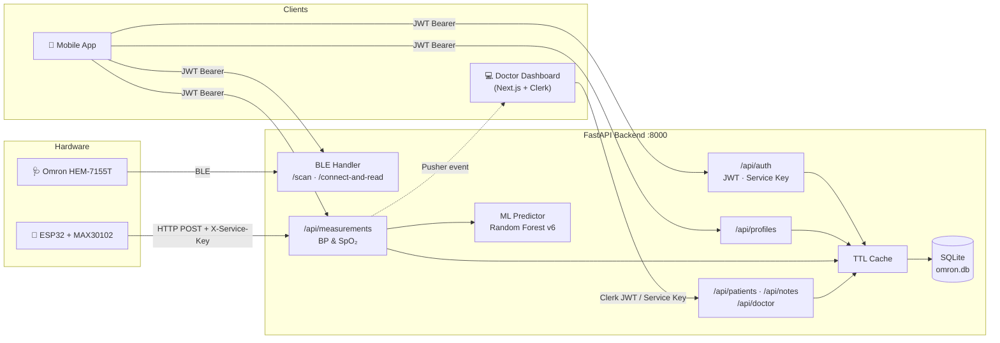

# 🩺 Tensimeter & MAX30102 — Remote Patient Monitoring Backend

Backend **FastAPI** untuk sistem *Remote Patient Monitoring* (RPM) yang mengumpulkan data vital pasien dari dua sumber perangkat keras: tensimeter **Omron HEM-7155T** (tekanan darah via Bluetooth Low Energy) dan **ESP32 + MAX30102** (SpO₂, BPM, suhu via WiFi/HTTP). Data disimpan per profil keluarga (*multiuser & multi-profile*), diperkaya dengan **estimasi gula darah berbasis Machine Learning**, lalu disajikan ke aplikasi mobile dan *dashboard* dokter.

---

## 📚 Documentation Roadmap

Baca berurutan sesuai kebutuhan. README ini sengaja ringkas; detail teknis ada di dokumen berikut.

| # | Dokumen | Fokus |
|---|---------|-------|
| 1 | **README.md** (file ini) | Gambaran besar, setup lokal, dan arsitektur singkat. |
| 2 | [dokumentasi_api_lengkap.md](./dokumentasi_api_lengkap.md) | **Referensi API paling mutakhir**: *dual auth* (JWT + Service Key), *active session* SpO₂, ML in-process, panduan Postman langkah demi langkah. |
| 3 | [DOKUMENTASI_LENGKAP.md](./DOKUMENTASI_LENGKAP.md) | Dokumentasi teknis mendalam branch `optimasi`: diagram arsitektur/sequence, ERD, firmware & wiring ESP32, optimasi performa, troubleshooting, dan catatan keamanan. |
| 4 | [DOKUMENTASI_HEM7155T.md](./DOKUMENTASI_HEM7155T.md) | Spesifikasi protokol BLE Omron: format paket, *channel* UUID, *inheritance* driver, **memory map EEPROM**, dan format *binary record* HEM-7155T. |
| 5 | [implementation doctor.md](./implementation%20doctor.md) | Rancangan endpoint `GET /api/doctor` untuk memetakan user **Clerk** (Next.js) ke `id_user` lokal. |
| 6 | [omblepy-esp32bridge/README.md](./omblepy-esp32bridge/README.md) | Mode alternatif: komunikasi BLE lewat ESP32 sebagai *bridge* USB-serial (melewati *stack* Bluetooth OS). |

<details>
<summary>🗄️ Dokumen arsip / duplikat (tidak perlu dibaca)</summary>

| Dokumen | Status |
|---------|--------|
| [DOKUMENTASI_LENGKAP_080626.md](./DOKUMENTASI_LENGKAP_080626.md) | Salinan **identik** dari `DOKUMENTASI_HEM7155T.md` (snapshot 8 Juni 2026). |
| [readmeNEW backup.md](./readmeNEW%20backup.md) | Versi awal referensi API; sudah digantikan oleh `dokumentasi_api_lengkap.md`. |
| [README backup.md](./README%20backup.md) | Salinan README lama (panduan pairing & endpoint BLE dasar). |

</details>

> [!NOTE]
> Router `dashboard`, `notes`, dan `doctor` (endpoint `/api/patients/...`, `/api/notes/...`, `/api/doctor`) sudah ada di kode tetapi belum terdokumentasi lengkap di file mana pun. Untuk sementara, gunakan Swagger UI (`/docs`) sebagai sumber kebenaran.

---

## 🧰 Tech Stack & Prerequisites

### Tech Stack

| Layer | Teknologi |
|-------|-----------|
| **API Server** | Python 3.10+, FastAPI, Uvicorn (ASGI) |
| **Database** | SQLite (`omron.db`) via SQLAlchemy 2.x, mode WAL |
| **BLE** | `bleak` + modul `omblepy` + driver di [`deviceSpecific/`](./deviceSpecific/) |
| **Auth** | JWT (`python-jose`, bcrypt) untuk mobile; `X-Service-Key` untuk ESP32/server; Clerk JWKS (`PyJWT`) untuk dashboard dokter |
| **Machine Learning** | Random Forest v6 (`scikit-learn`, `joblib`), dijalankan *in-process* dari [`ml_model/`](./ml_model/) |
| **Real-time** | Pusher (broadcast event pengukuran baru) |
| **Performa** | `cachetools` (TTL cache), GZip middleware, `httpx`, `aiofiles`, `orjson`; stress test dengan k6 |
| **Firmware** | Arduino C++ untuk ESP32 (C3/S3) + MAX30102 + OLED (U8g2) |

### Prerequisites

- **OS:** Windows 10/11 (direkomendasikan) dengan adapter **Bluetooth 4.0+ (BLE)**.
- **Python 3.10+** dan `pip`.
- **Arduino IDE 2.x** (hanya jika ingin mem-*flash* firmware ESP32).
- **Hardware (opsional untuk development API):** Omron HEM-7155T, ESP32 + sensor MAX30102.
- Server, ESP32, dan aplikasi client berada di **jaringan LAN yang sama** (atau server diakses via domain publik).

---

## 🚀 Quick Start

### 1. Setup environment

```powershell
# (Opsional) virtual environment
python -m venv venv
venv\Scripts\activate            # Windows
# source venv/bin/activate       # Linux/Mac

# Install dependencies
pip install -r requirements.txt
# Di jaringan kampus/proxy yang memblokir SSL:
# pip install --trusted-host pypi.org --trusted-host files.pythonhosted.org -r requirements.txt
```

### 2. Konfigurasi `.env`

```powershell
copy .env.example .env
python secretkey-generate.py     # salin output ke SECRET_KEY di .env
```

| Variable | Wajib | Keterangan |
|----------|:-----:|------------|
| `SECRET_KEY` | ✅ | Kunci JWT. Server **gagal start** jika kosong. |
| `SERVICE_KEY` | ⚠️ | Kunci header `X-Service-Key` untuk ESP32 & dashboard. Wajib jika memakai sensor SpO₂. |
| `BCRYPT_ROUNDS` | ❌ | Default `4` (dev). Gunakan `10`+ di production. |
| `LOG_LEVEL` | ❌ | Default `WARNING`. |
| `PUSHER_APP_ID`, `PUSHER_KEY`, `PUSHER_SECRET`, `PUSHER_CLUSTER` | ❌ | Kredensial Pusher untuk broadcast real-time. |
| `CLERK_JWKS_URL`, `CLERK_JWT_ISSUER` | ❌ | Verifikasi token Clerk untuk endpoint dokter. |

> `ML_API_URL` di `.env.example` adalah sisa versi lama. Model ML kini dimuat langsung dari `ml_model/*.joblib`.

### 3. Jalankan server

```powershell
# (Opsional) tambah index DB untuk performa
python migrate_indexes.py

# Ganti 0.0.0.0 dengan IPv4 lokal agar bisa diakses perangkat lain di LAN
python -m uvicorn main:app --reload --host 0.0.0.0 --port 8000
```

- Health check: `GET http://localhost:8000/` → `{"message": "Omron BLE Python Backend is running"}`
- Swagger UI: `http://localhost:8000/docs` · ReDoc: `http://localhost:8000/redoc`

Tabel database dibuat dan dimigrasi otomatis saat *startup*.

### 4. (Opsional) Pairing Omron HEM-7155T

```powershell
# 1. Tekan lama tombol Bluetooth di tensimeter sampai muncul huruf "P"
# 2. Jalankan:
python ./omblepy.py -p -d hem-7155t
```

Setelah pairing, baca data via `POST /connect-and-read` atau `POST /latest-bp-records`. `user_index: 0` berarti slot User 1 dan `1` berarti User 2 pada alat. Detail lengkap ada di [dokumentasi_api_lengkap.md](./dokumentasi_api_lengkap.md).

### 5. (Opsional) Flash firmware ESP32 + MAX30102

Buka [`ESP32-S3 MAX30102/max30102_esp32c3_oled_oximeter/`](./ESP32-S3%20MAX30102/max30102_esp32c3_oled_oximeter/) di Arduino IDE. Sesuaikan `ssid`, password WiFi, `server_url`, dan `X-Service-Key`, lalu upload (Serial Monitor 115200 baud). Wiring dan algoritma ada di [DOKUMENTASI_LENGKAP.md §10](./DOKUMENTASI_LENGKAP.md#10-firmware-esp32--max30102).

---

## 🏗️ Core Architecture Overview



**Alur utama:**

1. **Onboarding:** user *register* → *login* (dapat JWT) → membuat satu atau lebih **profil** (Ayah, Ibu, Anak, dst.).
2. **Tekanan darah:** pengukuran di Omron → backend membaca via BLE → disimpan ke `measurements` (sys, dia, bpm, IHB, gerakan).
3. **SpO₂ + gula darah:** aplikasi mobile menetapkan **active session** (`POST /api/measurements/spo2/active-session`) → ESP32 mengirim `spo2`, `bpm`, `temperature` tanpa `id_profile` → backend menggabungkan data profil dan BP terakhir → ML memprediksi gula darah (kategori ADA) → disimpan ke `spo2_measurements`.
4. **Monitoring:** mobile app dan dashboard dokter membaca riwayat atau data terbaru, dengan notifikasi real-time via Pusher.

**Struktur direktori inti:**

```
main.py              # Entry point FastAPI, CORS, endpoint BLE
routers/             # auth, profiles, measurements, dashboard, notes, doctor
models.py / schemas.py / database.py / cache.py
omblepy.py, sharedDriver.py, deviceSpecific/   # Protokol & driver BLE Omron
ml_model/            # predictor.py + model_v6/scaler_v6/metadata_v6 (.joblib)
ESP32-S3 MAX30102/   # Firmware sensor SpO₂
omblepy-esp32bridge/ # Alternatif BLE via ESP32 bridge
k6_stress_test.js    # Stress test (50 → 200 VU)
```

---

## 🤝 Contribution & Rules

- **Branch:** pengembangan aktif ada di branch `optimasi`. Buat *feature branch* dari sana (mis. `feature/<nama-fitur>`, `fix/<nama-bug>`) dan ajukan Pull Request ke `optimasi`.
- **Struktur kode:** endpoint baru masuk ke `routers/<domain>.py` dan didaftarkan di `main.py` via `app.include_router(...)`. Skema request/response ditulis di `schemas.py`, model ORM di `models.py`.
- **Driver perangkat Omron baru:** tambahkan file `deviceSpecific/hem-xxxxt.py` berisi class `deviceSpecificDriver` yang mewarisi `sharedDeviceDriverCode` (dari `sharedDriver.py`). Lihat [DOKUMENTASI_HEM7155T.md §7](./DOKUMENTASI_HEM7155T.md#7-device-driver-devicespecific).
- **Perubahan skema DB:** perbarui `models.py` dan tambahkan migrasi (`migrate_db.py` / `ensure_sqlite_columns()`) agar database lama tetap kompatibel.
- **Keamanan:**
  - Jangan commit `.env`, kredensial WiFi, atau `SERVICE_KEY`. Saat ini firmware ESP32 masih menyimpan SSID dan service key secara *hardcoded*, jadi **ganti sebelum repositori dipublikasikan**.
  - Origin CORS masih *hardcoded* di `main.py`. Tambahkan origin baru di sana bila client berjalan di IP lain.
- **Dokumentasi:** setiap perubahan endpoint wajib diperbarui di [dokumentasi_api_lengkap.md](./dokumentasi_api_lengkap.md). Jangan membuat file dokumentasi baru yang tumpang tindih; perbarui dokumen yang sudah ada sesuai roadmap di atas.
- **Uji sebelum PR:** jalankan server, cek `/docs`, dan (untuk perubahan performa) jalankan `k6 run k6_stress_test.js`.
